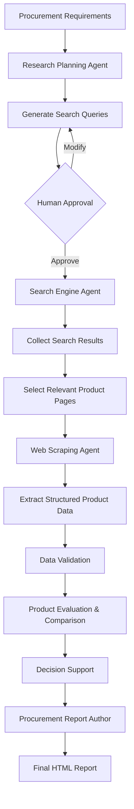

# System Architecture

## 1. Overview

The **AI-Powered Procurement Research & Decision Support System** is an AI-powered system designed to automate product research, collect structured procurement data, evaluate available alternatives, and generate comprehensive reports to support purchasing decisions.

The system follows a multi-agent architecture orchestrated through CrewAI. Each agent is responsible for a specific stage of the procurement research process, while external services provide search capabilities, web data extraction, language model inference, and observability.

The system is designed as a **Decision Support System**, not an autonomous purchasing system. It assists procurement teams by providing organized research, comparisons, and recommendations. Final purchasing decisions remain under human control.

## 2. Architectural Principles

The system is designed around the following principles:

- **Modular Responsibilities:** Each agent or component has a clearly defined responsibility.
- **Sequential Execution:** Research stages follow a controlled execution flow, where each stage depends on the results of previous stages.
- **Human Oversight:** Important research decisions, especially search scope and query approval, should include human review.
- **Structured Data:** Product information should follow predefined data schemas to improve consistency and downstream processing.
- **Data Reliability:** The system should distinguish between verified information, missing information, and uncertain information rather than inventing values.
- **Decision Support:** Recommendations should be based on collected evidence and defined evaluation criteria.
- **Observability:** Execution traces and failures should be monitored to support debugging and system improvement.

## 3. High-Level Architecture

The system consists of the following logical layers:

1. **Input Layer:** Receives procurement requirements and research preferences.
2. **Research Planning Layer:** Generates search queries and determines the research scope.
3. **Human Approval Layer:** Allows the user to review and approve generated search queries before execution.
4. **Research Execution Layer:** Searches the web and collects relevant product sources.
5. **Data Extraction Layer:** Extracts structured product information from selected pages.
6. **Validation & Evaluation Layer:** Validates collected data, handles incomplete records, and evaluates alternatives.
7. **Decision Support Layer:** Organizes comparisons and generates evidence-based recommendations.
8. **Reporting Layer:** Produces the final procurement research report.

## 4. System Workflow

The intended end-to-end workflow is described below.

The diagram represents the target workflow. Some stages are already represented in the current notebook implementation, while others are planned extensions.

### 4.1 Procurement Requirements

The process starts when the user provides the procurement requirements.

Expected input information includes:

- Product name or category.
- Required quantity.
- Product specifications.
- Target country or market.
- Preferred websites or suppliers, when applicable.
- Research language.
- Evaluation criteria and purchasing priorities.

The system uses these requirements to guide the research process.

### 4.2 Research Planning

The Research Planning Agent analyzes the procurement requirements and generates relevant search queries.

The intended research scope supports two main approaches:

- **Targeted Research:** Researching user-specified websites or suppliers.
- **Open Research:** Discovering relevant sources across the web.

The generated queries should be specific enough to identify relevant product pages and useful alternatives.

### 4.3 Human Approval

Before executing the search, the generated queries should be presented to the user for review.

The user can approve or modify the queries before the research process continues.

This approval step provides control over the research scope and helps reduce irrelevant search results.

### 4.4 Research Execution

The Search Engine Agent executes the approved queries through the search integration.

Its responsibility includes:

- Collecting search results from multiple queries.
- Identifying relevant product pages.
- Filtering irrelevant or unsuitable results.
- Considering search relevance scores.
- Preserving the source URLs for subsequent extraction.

### 4.5 Product Data Extraction

The Web Scraping Agent processes selected product pages and extracts structured information.

Expected product attributes include:

- Product title.
- Product URL.
- Product image URL.
- Current price.
- Original price, when available.
- Discount percentage, when available.
- Product specifications.
- Source information.

The extraction process should preserve the distinction between unavailable information and confirmed values.

### 4.6 Data Validation & Evaluation

Extracted product records should pass through a validation and evaluation stage before being used in the final comparison.

This stage is responsible for:

- Checking required fields.
- Identifying missing or inconsistent information.
- Preserving source references.
- Assessing data completeness.
- Evaluating products against the procurement requirements.
- Handling incomplete records without inventing missing values.

Products with incomplete information may be retained for further review when they still provide useful research value.

The system should distinguish between data completeness and data accuracy. A record containing all expected fields is not necessarily accurate.

### 4.7 Decision Support

After validation, the system organizes the available alternatives into a comparable structure.

The evaluation should consider the procurement requirements and relevant criteria rather than relying on price alone.

The system provides research-based recommendations and explains the reasoning behind the comparison.

It does not automatically approve suppliers, place orders, or execute purchasing transactions.

### 4.8 Report Generation

The Procurement Report Author Agent generates a professional report containing the research findings.

The intended report structure includes:

- Executive Summary
- Introduction
- Research Methodology
- Research Findings
- Product Comparison
- Analysis
- Recommendations
- Conclusion
- Appendices and Sources

The report should clearly communicate the available evidence, relevant limitations, and recommendations.

## 5. Agent Architecture

The system currently uses four CrewAI agents. Their responsibilities may be refined as the architecture evolves.

| Agent | Primary Responsibility |
|---|---|
| Search Queries Recommendation Agent | Generates relevant search queries. |
| Search Engine Agent | Searches for products and collects relevant search results. |
| Web Scraping Agent | Extracts structured product data and currently also produces initial recommendation rankings and notes. |
| Procurement Report Author Agent | Generates the final HTML procurement report. |

The detailed responsibilities, prompts, tools, inputs, outputs, and constraints of each agent are documented separately in `agents.md`.

## 6. Orchestration Layer

CrewAI acts as the orchestration framework responsible for coordinating the agents and their tasks.

The intended execution model is sequential:

1. Generate research queries.
2. Review and approve the queries.
3. Execute product searches.
4. Extract product information.
5. Validate and evaluate the collected data.
6. Generate the final report.

The orchestration layer is responsible for managing execution order and coordinating the outputs between stages.

The current notebook uses `Process.sequential`. The human approval interaction and the complete validation/evaluation flow are planned extensions to the existing workflow.

## 7. External Integrations

The system relies on external services for specialized capabilities.

| Integration | Responsibility |
|---|---|
| Language Model API | Agent reasoning, query generation, data extraction instructions, and report generation. |
| Tavily | Web search and retrieval of relevant search results. |
| ScrapeGraphAI | Extracting structured information from product pages. |
| Opik | Execution tracing and observability. |
| Google Generative AI Embeddings | Embedding configuration for the CrewAI knowledge component. |

The language model integration is shared across the agents.

Integration configuration, credentials, and implementation details should be documented in `tools-and-integrations.md`.

## 8. Knowledge Context

The system uses a company context knowledge source to provide additional business information to the agents.

This context currently contains information about Rankyx and its AI solutions.

The knowledge source can help align agent outputs with the company's business context and procurement research strategy.

Any expansion of the knowledge base should preserve a clear distinction between company information, procurement requirements, and product research evidence.

## 9. Data Contracts

Structured data is used to define the expected inputs and outputs of the system components.

Pydantic models provide the current schema definitions.

The main data contracts include:

- Search query results.
- Search engine results.
- Extracted product information.
- Product specifications.
- Collections of extracted products.

The data contracts should evolve to support additional reliability requirements, including:

- Explicit missing-data handling.
- Source and collection metadata.
- Consistent data validation.
- Clear separation between extraction results and evaluation results.

Detailed schemas should be documented in `data-structures.md`.

## 10. Reporting & Output Management

The system generates intermediate outputs and a final procurement report.

The current implementation stores generated artifacts in the `ai-agent-output/` directory.

Expected outputs include:

- Generated search queries.
- Search engine results.
- Extracted product details.
- Final HTML procurement report.

The output structure may be expanded to support validation results, incomplete product records, and additional research artifacts.

## 11. Reliability & Error Handling

The architecture should account for failures and inconsistencies across external integrations and agent execution.

Important reliability considerations include:

- Search API failures.
- Unavailable or inaccessible product pages.
- Extraction failures.
- Missing product attributes.
- Invalid or inconsistent structured outputs.
- LLM response failures.
- Report generation failures.

Failures should be represented explicitly and should not silently produce fabricated product information.

Each stage should expose enough information to identify the source of a failure and determine whether the affected operation can be retried or requires human intervention.

## 12. Observability

Opik is used to trace CrewAI execution.

Observability should help monitor:

- Agent execution.
- Task execution.
- Model interactions.
- Execution failures.
- Workflow performance.

As the system evolves, monitoring should also cover external API failures, extraction quality, and the reliability of generated product records.

## 13. Architectural Boundaries

The system is responsible for procurement research and decision support.

It is not responsible for:

- Automatically placing purchase orders.
- Executing financial transactions.
- Guaranteeing supplier credibility without independent verification.
- Guaranteeing that online prices remain unchanged after collection.
- Replacing human procurement approval.

The system provides structured information and recommendations to support the responsible purchasing team.

## 14. Future Architectural Considerations

The following areas may require further architectural refinement:

- Separating agent responsibilities from orchestration and business logic.
- Introducing a dedicated validation and evaluation component.
- Improving source verification and data quality checks.
- Supporting different research strategies.
- Introducing retry policies and controlled failure recovery.
- Improving report traceability through source references and collection timestamps.
- Supporting additional export formats.
- Introducing persistent storage for research history and comparison records.

These considerations should be evaluated based on implementation requirements and system complexity.